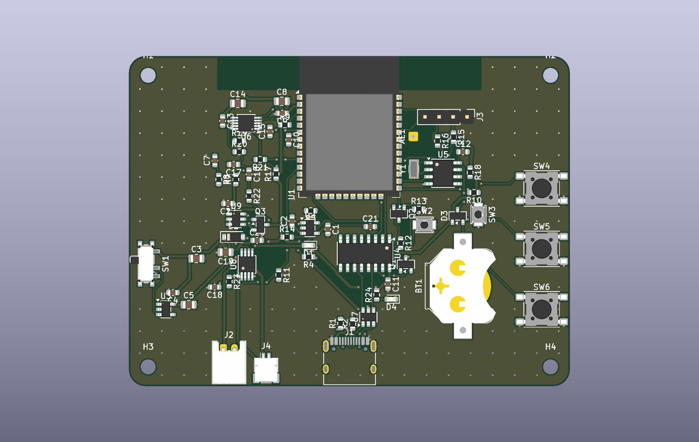
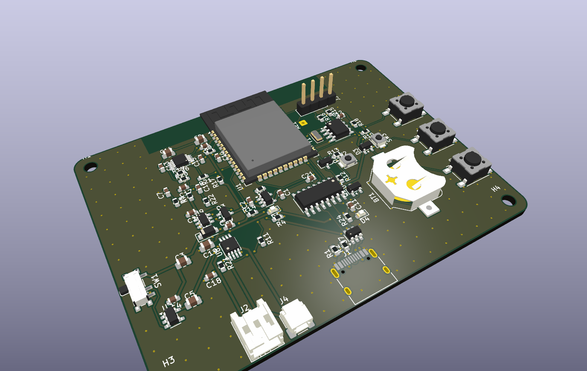
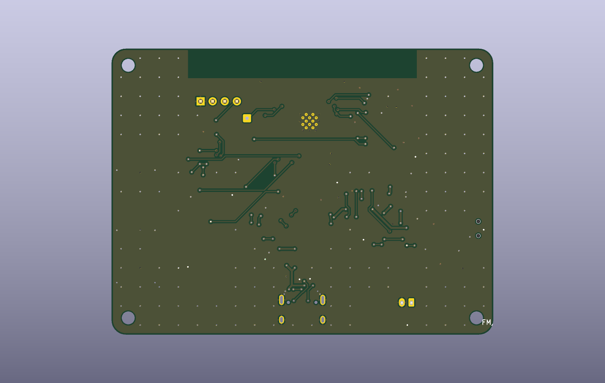

# FM/BT Pocket Radio

> 本檔由 `python -m aipcb previews` 自動產生，請勿手動編輯；設計來源是 `design.yaml`。

| 項目 | 內容 |
|---|---|
| 板子尺寸 | 80 × 60 mm，2 層，厚 1.6 mm |
| 零件 / 網路 | 72 顆 / 49 個 |
| DRC | 0 錯誤、0 未連接 |
| 自動檢查 | 通過（error 0、warning 47） |
| SPICE 模擬 | 4/4 通過 |
| AI 審核 | **CONDITIONAL**（2026-11-13T10:33:53） |

## 電路圖 Schematic

可放大的向量版：[docs/fm_radio_schematic.pdf](docs/fm_radio_schematic.pdf)

## PCB

  

## AI 審核摘要

依上一版審核的建議完成換件：電源路徑改為 LTC4412 + AO3401A 理想二極體（拔除 USB 時的 9 ms 掉壓消失，模擬已驗證），CR1220 電池座改為 LCSC 有貨的 Keystone 3000，其餘缺料號的零件都補上已確認的 LCSC 料號。重建結果：ERC 0、DRC 0/0、幾何檢查通過、模擬 4/4 通過。PCB 可打樣。唯一未解決的是 U6 RDA5807M 在 LCSC 沒有料，需另外採購或手焊，所以仍判定「有條件通過」。

- **[WARNING] U6 RDA5807M 沒有 LCSC 料號**
- **[WARNING] 電池低於約 3.33 V 時 3.3 V 軌脫離穩壓（模擬 02）**
- **[WARNING] OLED 模組腳位順序因廠商而異**
- **[WARNING] VSYS 有 3.2 mm 走線縮到 0.2 mm**

完整審核內容：[out/review.md](out/review.md)
