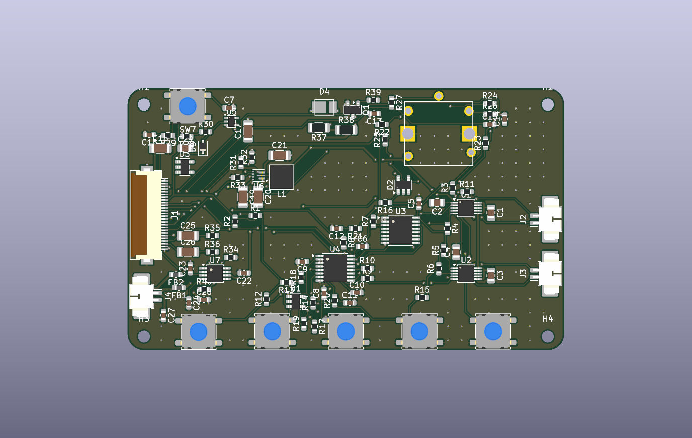
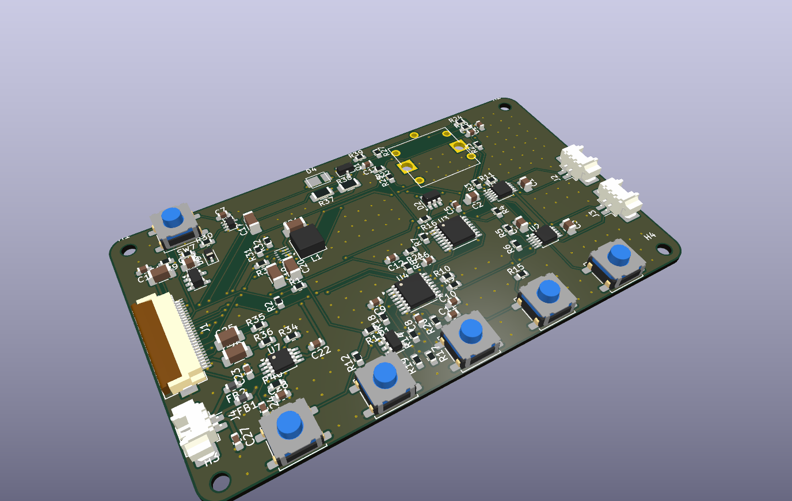
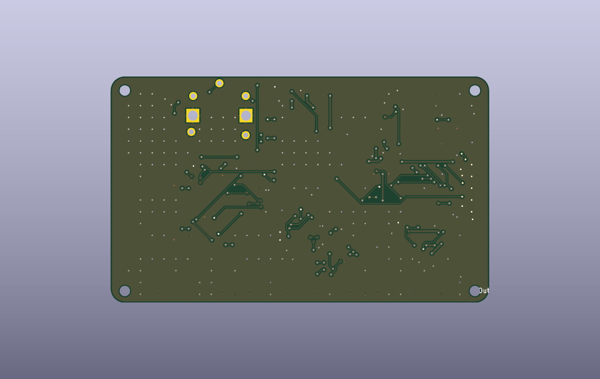

# Outdoor Hub — HMI & Alarm Board (Board 2)

> 本檔由 `python -m aipcb previews` 自動產生，請勿手動編輯；設計來源是 `design.yaml`。

| 項目 | 內容 |
|---|---|
| 板子尺寸 | 80 × 48 mm，2 層，厚 1.0 mm |
| 零件 / 網路 | 96 顆 / 59 個 |
| DRC | 0 錯誤、0 未連接 |
| 自動檢查 | 通過（error 0、warning 68） |
| SPICE 模擬 | 4/4 通過 |
| AI 審核 | **CONDITIONAL**（2026-11-13T10:08:21） |

## 電路圖 Schematic

可放大的向量版：[docs/outdoor_hmi_schematic.pdf](docs/outdoor_hmi_schematic.pdf)

## PCB

  

## AI 審核摘要

用目前引擎完整跑過一次流程（--keep，零件位置不變）：ERC 0、DRC 0/0、幾何鋪銅檢查通過、模擬全部通過。上一版的阻擋項「兩個 AI 繪製的封裝」已用原廠圖獨立核對，全部符合。剩下唯一的條件是 EC12D 固定腳插入橢圓槽的實體試裝；試裝 OK 就可以改判 PASS。

- **[WARNING] 剩下一項：實體試裝（EC12D 固定腳槽）**
- **[WARNING] FPC 連接器沒有 LCSC 庫存**
- **[WARNING] SOS 硬體 3 秒判定的誤差（未變）**

完整審核內容：[out/review.md](out/review.md)
